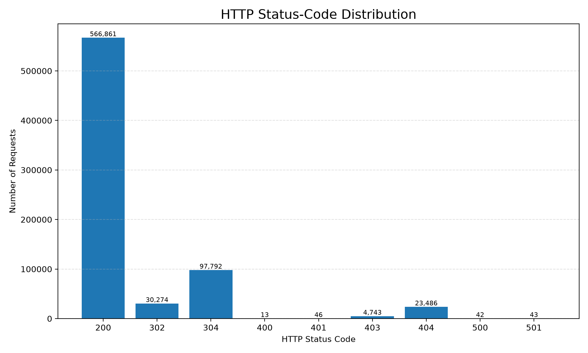
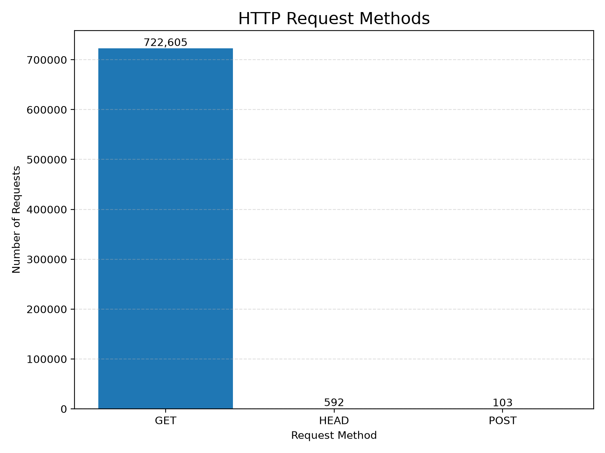
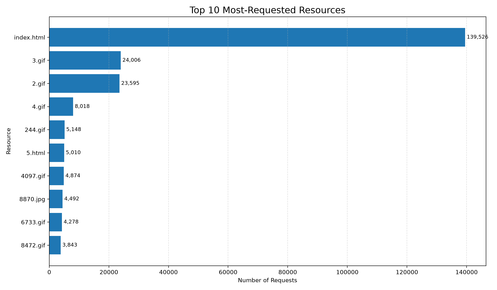

# Web Server Log Analysis Using Hadoop

## 1. Project Overview

The Web Server Log Analysis project uses Apache Hadoop and MapReduce to process web server access logs and identify useful patterns in HTTP requests.

Web server logs contain information about requests made to a server, including HTTP methods, requested resources, and HTTP response status codes. Analyzing these logs helps us understand how the server was accessed and how it responded to requests.

This project processes the Calgary HTTP access log dataset and generates summary statistics and visualizations.

### Objectives

- Process a large web server log dataset using Hadoop MapReduce.
- Count HTTP response status codes.
- Analyze HTTP request methods.
- Identify the most frequently requested resources.
- Visualize the results using Python and Matplotlib.
- Document the findings and limitations of the analysis.

## 2. Technologies Used

| Technology | Purpose |
|---|---|
| Java 17 | Programming language used for MapReduce |
| Apache Hadoop 3.3.6 | Distributed data processing framework |
| Hadoop HDFS | Storage of input data and MapReduce output |
| Hadoop MapReduce | Processing and aggregation of web server logs |
| Python 3.14.4 | Generating data visualizations |
| Matplotlib 3.11.2 | Creating graphs |
| Ubuntu on WSL | Linux environment on Windows |
| Visual Studio Code | Code editing and project development |
| Git and GitHub | Version control and project hosting |

## 3. Dataset Description

The project uses the Calgary HTTP access log dataset.

**Dataset source:**
https://ita.ee.lbl.gov/html/contrib/Calgary-HTTP.html

The dataset contains historical HTTP server access records. Each record may contain information about a request, such as the requested resource, HTTP method, response status, and other request details.

### Dataset Statistics

| Metric | Value |
|---|---:|
| Total input log records | 726,739 |
| Total valid records processed | 723,300 |
| Records not parsed by the project | 3,439 |
| Input file size | Approximately 50 MiB |

The MapReduce program identified 3,439 records that it could not parse according to its implemented parsing logic. These records were excluded from the aggregate statistics.

The number of valid records was calculated as:

**726,739 - 3,439 = 723,300**

## 4. System Workflow

The project follows these processing steps:

1. Obtain the Calgary HTTP access log dataset.
2. Extract the compressed dataset.
3. Upload the input log file to Hadoop HDFS.
4. Execute the Java MapReduce program.
5. Parse the log records and generate intermediate key-value pairs.
6. Aggregate the results using the MapReduce framework.
7. Save the aggregated output.
8. Analyze the output using Python.
9. Generate graphs for HTTP status codes, request methods, and frequently requested resources.
10. Document the results and findings.

## 5. Hadoop MapReduce Execution Results

The MapReduce job completed successfully.

### Processing Counters

| Counter | Value |
|---|---:|
| Map input records | 726,739 |
| Map output records | 2,169,900 |
| Combine output records | 11,886 |
| Reduce output records | 11,886 |
| Malformed lines | 3,439 |
| Output bytes | 258,755 |

The mapper processed the input records and generated intermediate key-value pairs. The combiner reduced the volume of intermediate data, and the reducer aggregated the counts.

The final output was saved locally as:

`results/analysis-output.txt`

The results were then used to generate the visualizations in the `graphs/` directory.

## 6. HTTP Status-Code Analysis

HTTP status codes describe the outcome of an HTTP request. The MapReduce program counted the occurrences of each recognized status code.

### Status-Code Distribution

| Status Code | Number of Requests | Meaning |
|---|---:|---|
| 200 | 566,861 | OK |
| 302 | 30,274 | Found / Redirect |
| 304 | 97,792 | Not Modified |
| 400 | 13 | Bad Request |
| 401 | 46 | Unauthorized |
| 403 | 4,743 | Forbidden |
| 404 | 23,486 | Not Found |
| 500 | 42 | Internal Server Error |
| 501 | 43 | Not Implemented |
| **Total** | **723,300** | |

### Visualization

### Findings

- **HTTP 200** was the most common status code, with 566,861 requests. This represents approximately 78.37% of all valid parsed records.
- **HTTP 304** occurred 97,792 times. This status indicates that a requested resource did not need to be transferred again because it had not changed, commonly in cache-validation scenarios.
- **HTTP 302** occurred 30,274 times and represents redirect responses.
- **HTTP 404** occurred 23,486 times, indicating that the requested resources were not found.
- **HTTP 403** occurred 4,743 times, indicating that access to the requested resources was forbidden.
- HTTP 400, 401, 500, and 501 occurred relatively infrequently in comparison with the most common status codes.

The combined count of the listed 4xx and 5xx responses was 28,373, approximately 3.92% of valid parsed records.

The 302 and 304 responses are not included in this 4xx/5xx count because redirects and cache-validation responses are not themselves client or server error status codes.

### Interpretation

The large number of HTTP 200 responses indicates that successful responses were the dominant category in this dataset. The presence of 404 responses suggests that some requests targeted resources that were unavailable at the time of access.

However, the counts alone do not establish why those resources were missing or whether the server experienced an operational problem.

## 7. HTTP Request-Method Analysis

HTTP methods describe the type of operation requested by a client.

### Request-Method Distribution

| HTTP Method | Number of Requests | Approximate Share |
|---|---:|---:|
| GET | 722,605 | 99.90% |
| HEAD | 592 | 0.08% |
| POST | 103 | 0.01% |
| **Total** | **723,300** | **100%** |

Percentages are rounded.

### Visualization

### Findings

- **GET** was overwhelmingly the most frequently used method, accounting for 722,605 requests.
- **HEAD** appeared 592 times. A HEAD request asks for response headers without requiring the response body.
- **POST** appeared 103 times and was much less common than GET.

### Interpretation

The request-method distribution shows that the observed traffic was dominated by GET requests. This is consistent with traffic involving the retrieval of web resources.

The small number of POST requests indicates that this method was relatively uncommon in the analyzed records. However, the counts do not reveal the precise purpose of individual POST requests.

## 8. Top 10 Most-Requested Resources

The MapReduce output was sorted by request count to identify the ten most frequently requested resources.

### Results

| Rank | Resource | Number of Requests |
|---:|---|---:|
| 1 | index.html | 139,526 |
| 2 | 3.gif | 24,006 |
| 3 | 2.gif | 23,595 |
| 4 | 4.gif | 8,018 |
| 5 | 244.gif | 5,148 |
| 6 | 5.html | 5,010 |
| 7 | 4097.gif | 4,874 |
| 8 | 8870.jpg | 4,492 |
| 9 | 6733.gif | 4,278 |
| 10 | 8472.gif | 3,843 |

### Visualization

### Findings

- `index.html` was the most frequently requested resource, with 139,526 requests.
- The second- and third-ranked resources were `3.gif` and `2.gif`, with 24,006 and 23,595 requests respectively.
- Several GIF and JPG resources appeared among the ten most-requested resources.
- The request count for `index.html` was substantially higher than the count for any other resource in the top ten.

### Interpretation

The results show that `index.html` was the most frequently requested resource in the analyzed dataset. The appearance of multiple image resources among the top ten suggests that image files also contributed to the observed request volume.

These counts represent requests recorded in the logs, not necessarily unique visitors or unique page views.

## 9. Key Findings

The analysis produced the following major findings:

1. **Successful responses dominated:** HTTP 200 was the most common status code, accounting for approximately 78.37% of valid parsed records.
2. **GET requests dominated traffic:** GET accounted for approximately 99.90% of recognized HTTP-method records.
3. **The homepage was the most requested resource:** `index.html` received 139,526 requests.
4. **Not-found responses were present:** HTTP 404 occurred 23,486 times.
5. **Some records could not be parsed:** The project identified 3,439 input records that did not match its parsing logic.
6. **Hadoop processed the dataset successfully:** The MapReduce job generated aggregated results that were used for further analysis and visualization.

## 10. Project Limitations

The results should be interpreted in the context of the dataset and the project's implementation.

- **Historical dataset:** The analysis describes the Calgary HTTP dataset, not current web traffic.
- **Parsing limitations:** The project could not parse 3,439 records according to its implemented parsing logic. Their contents and causes were not independently investigated.
- **Aggregate analysis:** The current analysis focuses on counts rather than individual request histories.
- **No unique-visitor analysis:** The project does not determine the number of unique users or visitors.
- **No session analysis:** User sessions and navigation paths are not analyzed.
- **No response-time analysis:** The current results do not measure request latency or server response duration.
- **No time-series analysis:** The current output does not establish traffic patterns by hour, day, or month.
- **Limited interpretation of resources:** Resource counts represent identifiers recorded in the logs and do not necessarily correspond to unique pages or users.
- **Limited causal conclusions:** The observed counts do not establish the causes of errors, redirects, or resource popularity.

## 11. Future Improvements

The project could be extended in several ways:

1. Analyze request patterns over time.
2. Identify frequently requesting IP addresses, where appropriate and supported by the dataset.
3. Investigate the most frequently requested missing resources.
4. Separate client errors from server errors in additional visualizations.
5. Improve parsing coverage and examine records that the current parser does not recognize.
6. Create additional charts for status-code percentages and request distributions.
7. Develop a dashboard for interactive exploration of the results.
8. Compare traffic patterns across different log datasets.
9. Add automated tests for the log-parsing and aggregation logic.
10. Document performance measurements for processing the dataset.

## 12. Conclusion

This project demonstrates the use of Apache Hadoop MapReduce to process and aggregate a web server access log dataset.

The program processed 726,739 input records, of which 723,300 were included in the aggregate statistics. It generated counts for HTTP status codes, request methods, and requested resources. Python and Matplotlib were then used to visualize the results.

The analysis found that HTTP 200 was the most common response status, GET was the dominant request method, and `index.html` was the most frequently requested resource.

Overall, the project demonstrates a practical workflow for large-scale log processing using Hadoop, from input preparation and HDFS storage to MapReduce aggregation, visualization, and reporting.